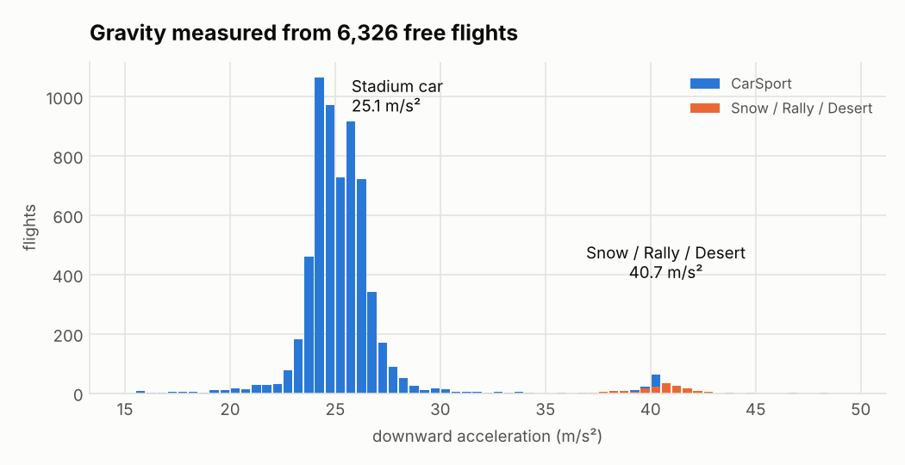
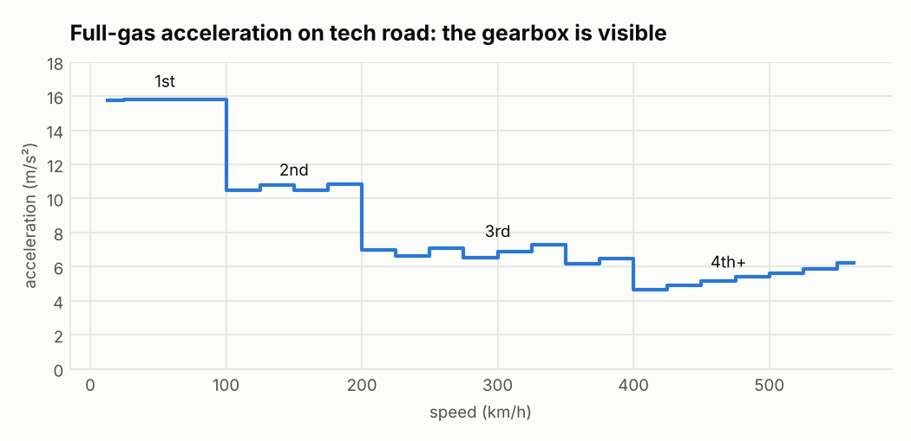
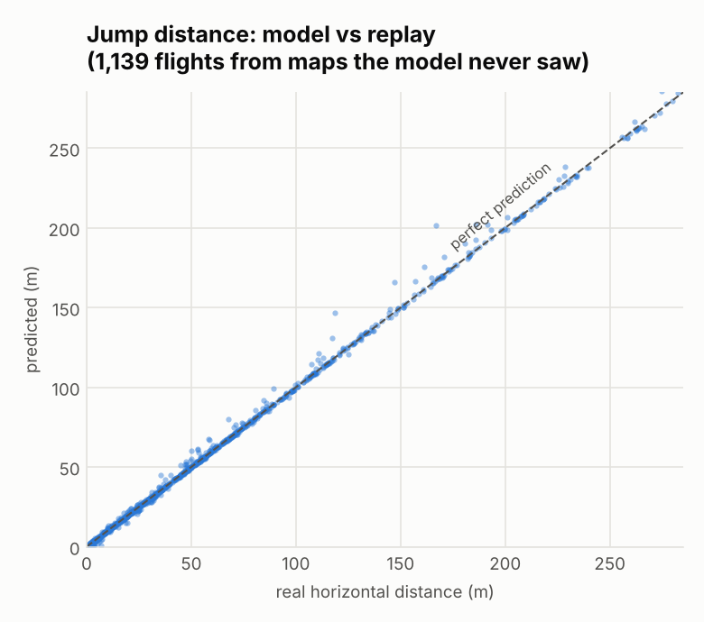
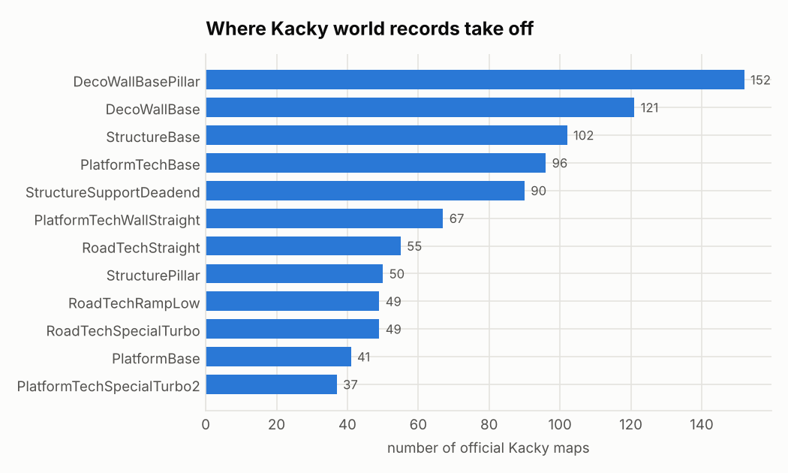

# 🏎️ TM2020 Claude Tracks

**Trackmania 2020 maps designed by Claude, measured against real driving data.**
The end goal is a [Kacky](https://kacky.gg) map: brutally hard, every obstacle intentional,
and every jump predicted *before* it's built.

Nothing here is guessed when it can be measured. Block geometry comes from 740 real maps.
Car physics comes from **3,943 replays** (official Kacky world records + trackmania.exchange),
parsed sample by sample.

| | |
|---|---|
| 🧪 Physics model | gravity, air drag, per-surface acceleration, validated on maps it never saw |
| 📐 Jump predictor | short jumps land within **0.7 m** of the real replay (median) |
| 🗺️ Kacky jump table | **17,407** world-record jumps, by takeoff block |
| 🧱 Block shapes | footprints + connections for **2,415** block/direction pairs, learned from real maps |
| ✅ Track checker | every build is walked start → finish before it reaches the game |
| 🏁 Tracks | [Proofcut](tracks/speedtech/proofcut), [Compass](tracks/beginner/compass), [Drop Test](tracks/stunts/droptest) (first physics-sized jumps) |

Roadmap: [`docs/ROADMAP.md`](docs/ROADMAP.md) · Tasks: [Issues](https://github.com/SemyonGit/tm2020-claude-tracks/issues)

---

## What the data says

### Two gravities
The Stadium car falls at **25.1 m/s²**, about 2.5× real gravity. Snow, Rally and Desert cars fall
at **40.7 m/s²**. The same jump lands somewhere completely different depending on the car.

<picture>
  <source media="(prefers-color-scheme: dark)" srcset="docs/img/gravity-dark.png">
  
</picture>

### The gearbox, from replays alone
Full-gas acceleration on tech road drops in steps: 1st gear up to 100 km/h, 2nd to 200, 3rd to 400.
Nobody told the model about gears. They show up in the data.

<picture>
  <source media="(prefers-color-scheme: dark)" srcset="docs/img/gears-dark.png">
  
</picture>

### Predicting jumps
Each flight is replayed through the model from its takeoff speed and compared with where the car
really was. The model was fitted on 80% of the maps and tested on the other 20%.

<picture>
  <source media="(prefers-color-scheme: dark)" srcset="docs/img/jump_accuracy-dark.png">
  
</picture>

| Flight time | Median error | 90% within |
|---|---|---|
| ≤ 1.5 s | 0.66 m | 2.0 m |
| > 1.5 s | 2.9 m | 10.1 m |

The big misses turned out to be mid-air body collisions, not Kacky bugs or air control. They're
filtered out now.

### Kacky isn't a road game
World-record jumps on official Kacky maps mostly take off from walls and structures, not road.

<picture>
  <source media="(prefers-color-scheme: dark)" srcset="docs/img/kacky_takeoffs-dark.png">
  
</picture>

Full table with speeds, angles and distances: [`docs/jump_table.md`](docs/jump_table.md).

---

## Try the tools

```bash
# How far does a 300 km/h launch off a 15° ramp go?
python tools/physics/jump.py 300 15
#   distance_blocks 4.21   peak_blocks 1.16   airtime_s 1.72

# How fast am I after 10 blocks of full gas on dirt?
python tools/physics/ground.py 10 Dirt
#   speed 256.3 km/h after 10 blocks, 7.61 s

# Will the car clear the gaps in this track? (ground model → take-off speed → air model)
python tools/physics/plan_jumps.py tracks/stunts/droptest/droptest.json
#   jump 11: 277 km/h, flies 1.90 blocks over a 1-block gap, lands +28.6 m  ok
#   jump 20: 345 km/h, flies 3.33 blocks over a 3-block gap, lands +10.5 m  ok

# Does this map connect start → finish?
python tools/verify_track.py tracks/beginner/compass/Compass.Map.Gbx
#   ✅ Compass.Map.Gbx  reached finish after 17 blocks
```

## How a track gets built

```
design.json         path of segments: start, straight ×4, curve_right, checkpoint, …
   ↓ compose.py      walks the grid → exact block coordinates and directions
   ↓ build.py        → .Map.Gbx (vendored gbx-py), unique map UID
   ↓ verify_track    start → finish walk using block shapes learned from real maps
TM2020              test drive: the final word
```

```bash
python compose.py tracks/beginner/compass/compass.design.json
python converter/build.py tracks/beginner/compass/compass.json
```

## How the physics was measured

```
kacky.gg + trackmania.io + trackmania.exchange      maps + world-record ghosts
   ↓ tools/ghost_probe   (C#, GBX.NET)               every 50 ms: position, velocity, inputs, wheel surface
   ↓ tools/physics/      fit_air / holdout / fit_ground / jumps / jump_table
docs/jump_table.md, tools/physics/jump.py, ground.py
```

Free flight = no wheel contact, normal sim speed, no reactor boost, no mid-air collision.
Gravity and drag are fitted per car, and errors are reported on maps held out from the fit.

## Layout

```
compose.py, track_lib/      design path → connected block list
converter/                  JSON → .Map.Gbx (gbx-py), runs verify_track after building
tools/ghost_probe/          replays → telemetry CSV, maps → block CSV  (.NET 10)
tools/physics/              air + ground model, jump table, charts, downloaders
tools/vocab/                block footprint/exit learner
tools/verify_track.py       offline start → finish checker
tests/                      pytest
tracks/{category}/{name}/   designs, track JSON, built maps
docs/                       roadmap, jump table, charts, session log
```

## Status

| | |
|---|---|
| ✅ | maps load in TM2020; straights, curves, checkpoints driven in-game |
| ✅ | physics model + jump table + offline track checker |
| ⏳ | Start/Finish fix for north/south tracks and unique map IDs: waiting for a test drive ([#4](https://github.com/SemyonGit/tm2020-claude-tracks/issues/4), [#21](https://github.com/SemyonGit/tm2020-claude-tracks/issues/21)) |
| ⬜ | live editor control via Openplanet bridges ([#2](https://github.com/SemyonGit/tm2020-claude-tracks/issues/2)) |
| ⬜ | platforms, loops, free blocks → first jump gauntlet → Kacky map ([#20](https://github.com/SemyonGit/tm2020-claude-tracks/issues/20)) |

Built with [Claude Code](https://claude.com/claude-code). Ghost/map parsing by
[GBX.NET](https://github.com/BigBang1112/gbx-net) and [gbx-py](https://github.com/schadocalex/gbx-py).
Measured map geometry cross-checked against [kacky-code/tm2020-mcp](https://github.com/kacky-code/tm2020-mcp).
